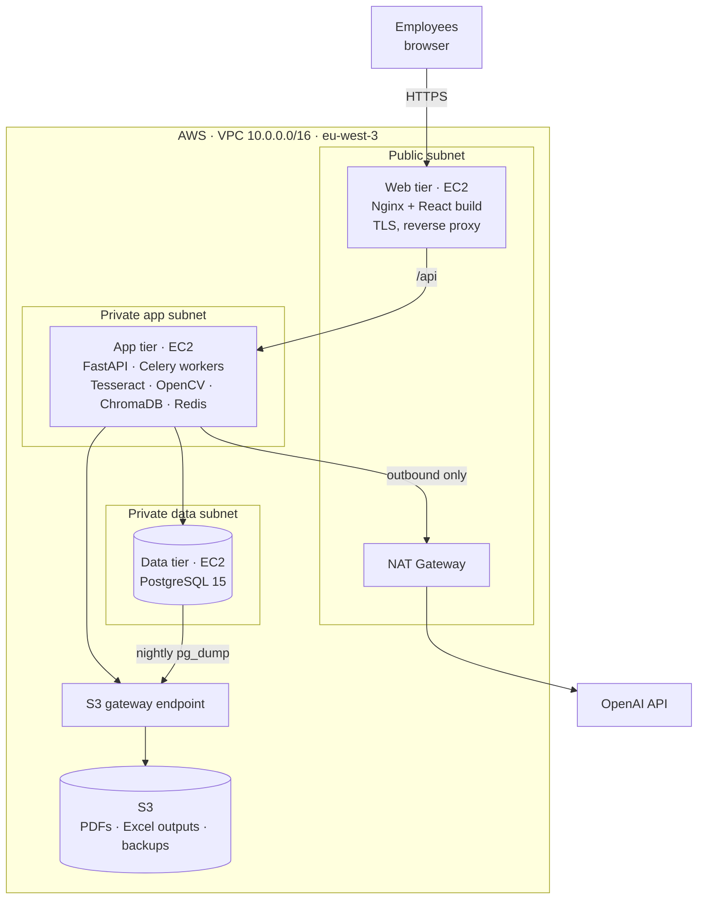

# 📄 SCP Document AI Platform — PDF-to-Excel Automation, AWS Deployment & RAG Assistant

> **Technical case study** of the platform I built as an **AI Developer at SCP** (Megrine, Tunisia, 12/2024 – 05/2025).
> The source code is proprietary and covered by a confidentiality agreement, so this repository contains **no company code or data**. It documents the problem, the pipeline, the architecture, the AWS deployment, the chatbot design and the results. The snippets were written from scratch for this case study to show the approach, and any business figures in examples are illustrative.

---

## TL;DR

SCP's finance, logistics and import/export teams processed **hundreds of PDF business documents every week**: supplier invoices, customs declarations, export invoices, packing lists, delivery notes and more. Each one was **typed into Excel by hand**.

I designed, built and deployed a 3-tier platform with two products:

### 1. PDF-to-Excel automation
Upload PDFs → choose the document type → **OCR (Tesseract) + OpenCV preprocessing** → **classification of the extracted information** into business fields (hybrid rules + ML + supplier templates) → **automatic validation** (totals, VAT, duplicates) → **automatic Excel filling** in the company's own templates, with **optional human validation** in a side-by-side review screen.

- **99.7% field-level accuracy**
- **100 documents processed in 20 minutes** (vs. ~7 hours of manual entry)

### 2. Employee AI assistant (RAG chatbot)
A chatbot built on the **OpenAI API + ChromaDB** that answers from **company documents** (procedures, policies, contracts) **and the company database** (e.g. *"What were our exact export figures for March 2025?"*). Exact figures come from **safe, parameterized SQL tools**, not from the LLM's memory. **Guardrails** keep it limited to work-related questions.

### Deployment
The full stack (**React frontend, FastAPI backend, PostgreSQL database**) is deployed on **AWS** with a 3-tier **VPC** (public / private app / private data subnets), **EC2**, **S3** for documents and backups, and least-privilege **IAM** roles.

---

## Architecture at a glance

---

## My role

I was the **AI developer responsible for the whole project**. I worked with the IT manager (infrastructure approvals, AWS account), the finance and logistics teams (requirements, test documents, validation) and a front-end intern on part of the React UI.

- Analysed the existing manual workflow and the document types with the business teams.
- Designed and built the OCR + extraction + validation pipeline and the Excel generation.
- Built the FastAPI backend and the PostgreSQL schema, and contributed to the React frontend (review screen, upload flow).
- Designed and deployed the AWS infrastructure (VPC, subnets, security groups, EC2, S3, IAM).
- Designed and built the RAG chatbot with its tools and guardrails.
- Wrote the evaluation datasets and measured accuracy, speed and chatbot quality.

---

## Documentation

| Document | What's inside |
|---|---|
| [docs/01-context-and-goals.md](docs/01-context-and-goals.md) | Business context, document types, manual workflow, requirements |
| [docs/02-document-automation-pipeline.md](docs/02-document-automation-pipeline.md) | Step-by-step pipeline: upload → OCR → classification → validation → Excel |
| [docs/03-architecture-and-aws-deployment.md](docs/03-architecture-and-aws-deployment.md) | 3-tier design, data model, API, AWS VPC / EC2 / S3 / IAM, security, CI/CD, backups |
| [docs/04-rag-chatbot.md](docs/04-rag-chatbot.md) | RAG ingestion, database tools, routing, prompting, guardrails |
| [docs/05-results.md](docs/05-results.md) | Accuracy, throughput, chatbot evaluation, business impact |
| [docs/06-challenges-and-lessons.md](docs/06-challenges-and-lessons.md) | Hard problems, trade-offs, next steps |

---

## Key results

| Area | Metric | Result |
|---|---|---|
| Document automation | Field-level extraction accuracy (after automatic validation) | **99.7%** |
| | Throughput | **100 documents in 20 min** (~12 s per document) |
| | Manual data-entry time for 100 documents | **~7 h → 20 min (+ ~10 min optional review)** |
| | Documents needing no human correction | **~96%** |
| Chatbot | Correct answers on document questions | **~91%** |
| | Exact numeric answers on database questions | **~97%** (100% when routed to the right tool) |
| | Off-topic / out-of-scope requests refused | **~97%** |
| | Median response time | **~2 s** |
| Infrastructure | Uptime over the deployment period | **~99.8%** |

---

## Tech stack

| Layer | Technologies |
|---|---|
| OCR & vision | Tesseract 5 (LSTM, `fra+eng+ara`), OpenCV, PyMuPDF, pdf2image |
| Extraction & ML | Regex / anchor rules, scikit-learn (TF-IDF + LinearSVC document classifier, HistGradientBoosting field classifier), RapidFuzz |
| Excel | openpyxl (company templates, formulas and formatting preserved) |
| Backend | Python 3.11, FastAPI, Pydantic, SQLAlchemy, Alembic, Celery + Redis |
| Frontend | React 18, TypeScript, React Query, PDF.js (review screen), Tailwind CSS |
| Database | PostgreSQL 15 |
| AI assistant | OpenAI API (`gpt-4o-mini`, `text-embedding-3-small`, Moderation), ChromaDB, function calling |
| Cloud | AWS VPC, EC2, S3, IAM, NAT Gateway, S3 gateway endpoint, CloudWatch, SSM Session Manager |
| DevOps | Docker, Docker Compose, Nginx, Let's Encrypt, GitHub Actions |

---

*Built by [Mahdi Bel Haj Said](https://github.com/Mahdi-Bel-Haj-Said). Happy to walk through the design in an interview.*
