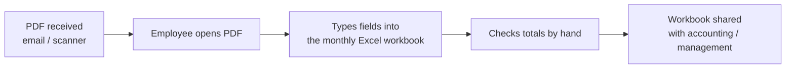

# 01 · Context & Goals

## Business context

SCP is an industrial company in Megrine (Tunis) with significant **import and export activity**. Every day, its finance, purchasing and logistics teams receive PDF documents (emailed, scanned or exported from partners' systems) and copy their contents into **Excel workbooks**. Those workbooks feed accounting, customs follow-up and management reporting.

## Document types handled

| Type | Typical source | Key fields extracted |
|---|---|---|
| **Supplier invoices** | Local and foreign suppliers (PDF / scans) | Supplier, tax ID (*matricule fiscal*), invoice no., date, currency, line items, total excl. tax (HT), VAT by rate, stamp duty, total incl. tax (TTC), due date |
| **Customs declarations (import)** | Customs broker | Declaration no., date, regime, HS codes, origin, customs value, duties and taxes, invoice references |
| **Export invoices / export declarations** | Internal + customs | Client, destination country, Incoterm, currency, quantities, FOB / CIF value, declaration no. |
| **Packing lists** | Logistics | Packages, gross / net weight, volume, references |
| **Delivery notes** (*bons de livraison*) | Suppliers / clients | Delivery no., date, PO reference, items, quantities |
| **Purchase orders** (*bons de commande*) | Internal | PO no., supplier, items, quantities, prices |

Most documents were in **French**, some in **English**, and a few contained **Arabic** (mainly stamps and headers). About **60% were scans or photos**, and about 40% were "native" PDFs with a text layer.

## The manual workflow (before)

- **~4 minutes per document** on average (simple invoice ≈ 2 min, multi-page customs declaration ≈ 10 min).
- 100 documents ≈ **7 hours** of one employee's day.
- Typing errors (swapped digits, wrong VAT rate, duplicates) were found only at month-end reconciliation.
- Answering a question like "how much did we export to client X in March?" meant opening several workbooks and filtering by hand.

## Goals

| # | Goal | Target | Achieved |
|---|---|---|---|
| G1 | Automate PDF → Excel for the main document types | ≥ 98% field accuracy | **99.7%** |
| G2 | Process a daily batch in minutes, not hours | 100 docs < 30 min | **100 docs in 20 min** |
| G3 | Keep humans in control | Optional review screen, with every uncertain field flagged | ✅ |
| G4 | Fit the existing Excel workflow | Fill the company's own templates, no format change for downstream users | ✅ |
| G5 | Secure, maintainable deployment | Cloud deployment with private networking and least privilege | ✅ AWS 3-tier |
| G6 | Make company knowledge and data queryable | Employee chatbot with exact figures and restricted scope | ✅ RAG + SQL tools + guardrails |

## Constraints

- **Confidential financial data:** no documents could leave the company's control except the minimum text sent to the OpenAI API for the chatbot (approved by management, with no training on API data under OpenAI's API data policy).
- **Mixed quality scans:** stamps over text, skewed pages, faxed copies.
- **Tunisian specifics:** the dinar uses **3 decimal places** (millimes), the VAT rates are 19% / 13% / 7%, there is a fixed stamp duty (*timbre fiscal*), the *matricule fiscal* has its own format, and dates are DD/MM/YYYY.
- **Budget:** a modest AWS budget, so a few right-sized EC2 instances rather than managed services everywhere.
