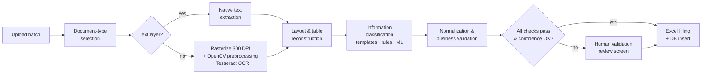

# 02 · PDF-to-Excel Automation Pipeline



---

## 1. Upload & job creation

- Drag-and-drop upload of up to **100 PDFs per batch** in the React app. Files go straight to S3 (`raw/{batch_id}/{doc_id}.pdf`) and a `batch` + `documents` record is created in PostgreSQL.
- **SHA-256 hash check:** a file that was already processed is flagged as a duplicate before any OCR runs.
- Each document becomes a **Celery task**, so the batch is processed in parallel by the worker pool (8 processes on the app server).

## 2. Document-type selection

The user **selects the document type** for the batch, or per file (invoice, import declaration, export invoice, …). That selection decides the extraction schema, the rules and the Excel template.

As a safety net, a **TF-IDF + LinearSVC classifier** (scikit-learn), trained on the first-page text of ~1,500 labelled documents (98.9% accuracy), predicts the type as well. If the prediction disagrees with the user's choice at high confidence, the UI warns: *"This looks like a delivery note, not an invoice."* This caught a lot of mis-sorted files.

## 3. Text extraction

### Native PDFs (≈40%)
**PyMuPDF** reads the text layer with exact word coordinates: fast (< 0.2 s/page) and 100% character-accurate. A sanity check (enough characters, valid encoding) decides whether to trust the text layer or fall back to OCR. Some PDFs have a broken or garbage text layer.

### Scanned PDFs (≈60%): OpenCV + Tesseract

| Step | Technique | Why |
|---|---|---|
| Rasterize | PyMuPDF at 300 DPI | Tesseract's sweet spot for small fonts |
| Grayscale + denoise | `cv2.fastNlMeansDenoising`, median blur | Scanner noise, fax artifacts |
| **Deskew** | Angle from `minAreaRect` of text pixels (validated with Hough lines), then `warpAffine` | Skewed scans destroy OCR line detection |
| Binarize | Adaptive (Sauvola-style) thresholding | Uneven lighting, coloured backgrounds |
| Stamp removal | HSV colour masking of blue/red ink, then inpainting | Stamps over totals were a major error source |
| Table lines | Morphological opening with long horizontal and vertical kernels → saved as a table mask, removed before OCR | Lines confuse Tesseract, but we need them for table structure |
| OCR | **Tesseract 5 LSTM** (`--oem 1 --psm 6`, `fra+eng`, `+ara` when needed), `image_to_data` for word boxes and confidences | Word-level geometry for the next steps |
| Domain vocabulary | `--user-words` file with supplier names, product codes and customs terms | Fewer errors on company-specific words |

```python
# Illustrative snippet, written for this case study
import cv2, numpy as np, pytesseract

def deskew(gray: np.ndarray) -> np.ndarray:
    thr = cv2.threshold(gray, 0, 255, cv2.THRESH_BINARY_INV | cv2.THRESH_OTSU)[1]
    coords = np.column_stack(np.where(thr > 0)).astype(np.float32)
    angle = cv2.minAreaRect(coords)[-1]
    angle = -(90 + angle) if angle < -45 else -angle
    if abs(angle) < 0.3:
        return gray
    h, w = gray.shape
    M = cv2.getRotationMatrix2D((w // 2, h // 2), angle, 1.0)
    return cv2.warpAffine(gray, M, (w, h), flags=cv2.INTER_CUBIC, borderMode=cv2.BORDER_REPLICATE)

def ocr_words(img: np.ndarray, lang="fra+eng"):
    data = pytesseract.image_to_data(img, lang=lang, config="--oem 1 --psm 6",
                                     output_type=pytesseract.Output.DICT)
    return [
        {"text": t, "conf": float(c), "box": (x, y, w, h), "line": (b, p, l)}
        for t, c, x, y, w, h, b, p, l in zip(
            data["text"], data["conf"], data["left"], data["top"], data["width"],
            data["height"], data["block_num"], data["par_num"], data["line_num"])
        if t.strip() and float(c) >= 0
    ]
```

## 4. Layout & table reconstruction

- **Lines:** words grouped into lines by vertical overlap, sorted left to right. Lines are grouped into blocks by spacing.
- **Ruled tables:** the table mask from step 3 gives the cell grid (intersections of horizontal and vertical lines), and each word is assigned to its cell.
- **Borderless tables:** column boundaries come from the x-positions of the detected header words (`Désignation`, `Qté`, `P.U.`, `Montant`…). Rows are split on line gaps, and multi-line descriptions are merged.
- The output is a structured page model: `blocks[]`, `lines[]`, `tables[] → rows[] → cells[]`, each with coordinates and OCR confidence.

## 5. Information classification (field extraction)

Each document type has a **schema** (e.g. 14 header fields + line items for invoices). Every field is filled by **three strategies in order of precision**, and the best-confidence candidate wins:

| Strategy | How it works | Coverage |
|---|---|---|
| **Supplier templates** | For the ~30 most frequent suppliers (≈65% of invoice volume), a template stores the relative position of each field. The supplier is identified by tax ID or name (RapidFuzz) | Highest precision |
| **Anchor + regex rules** | Find a label (`Facture N°`, `Date`, `Total TTC`, `Net à payer`, `Matricule fiscal`…) and read the value to its right or below. Validate with a typed regex | Generic, works for unseen layouts |
| **ML field classifier** | A **HistGradientBoosting** classifier (scikit-learn) labels candidate text spans as `invoice_number`, `invoice_date`, `total_ht`, `total_ttc`, `vat_amount`, … Features: regex type, relative page position, nearest anchor word and its distance, font height, neighbouring tokens. Trained on ~1,500 annotated documents | Fills gaps when rules find nothing or conflict |

Typed patterns used for validation and candidate generation:

```python
# Illustrative snippet, written for this case study
import re

PATTERNS = {
    # Tunisian tax ID, e.g. 1234567A/M/000
    "matricule_fiscal": re.compile(r"\b\d{7}[A-Z]/?[ABDNP]/?[ACMNP]/?\d{3}\b"),
    "date_fr": re.compile(r"\b(0?[1-9]|[12]\d|3[01])[/.-](0?[1-9]|1[0-2])[/.-](20\d{2})\b"),
    # 1 234,567 | 1.234,567 | 1234.567  (TND has 3 decimals, EUR/USD 2)
    "amount": re.compile(r"\b\d{1,3}(?:[ . ]?\d{3})*(?:[.,]\d{2,3})\b"),
    "hs_code": re.compile(r"\b\d{4}\.?\d{2}(?:\.?\d{2,4})?\b"),
    "incoterm": re.compile(r"\b(EXW|FCA|FAS|FOB|CFR|CIF|CPT|CIP|DAP|DPU|DDP)\b"),
}
```

## 6. Normalization & business validation

Values are normalized (amounts → `Decimal` with the right number of decimals per currency, dates → ISO, supplier → master-data ID). Then **cross-field checks** run. They are the reason accuracy goes from ~97.9% (raw extraction) to **99.7%**:

| Check | Rule |
|---|---|
| Totals | `total_HT + Σ VAT + stamp_duty = total_TTC` (± 0.001 TND) |
| Line items | `qty × unit_price = line_total` for each line, and `Σ line_total = total_HT` |
| VAT | Rate ∈ {19%, 13%, 7%, 0%}, and `VAT = base × rate` |
| Identity | Supplier tax ID exists in master data, or is flagged as a new supplier |
| Duplicates | Same supplier + invoice number already in the database → blocked |
| Dates | Not in the future, and due date ≥ invoice date |
| Customs | Declaration number format, HS code format, and declared value consistent with the linked invoice |

**Automatic self-correction:** when a check fails and one field has low OCR confidence, the system **re-OCRs that field's crop** with a digits-only whitelist and a different page segmentation mode. It then tries common OCR confusions (`8↔3`, `5↔6`, `1↔7`, `,↔.`) and keeps the candidate that **makes the equation balance**. This fixed about half of the failed checks with no human involved.

Every field ends with a **confidence score** (OCR confidence × extraction strategy prior × validation result).

## 7. Human validation (optional)

Two modes, chosen per batch:

- **Auto mode:** documents where every check passes and every field is above the confidence threshold go straight to Excel. Only flagged documents wait for review (≈4% of documents).
- **Review-all mode:** for sensitive batches (e.g. month-end closing), every document is shown for confirmation.

The **review screen** (React + PDF.js) shows the PDF on the left with **bounding boxes highlighted** for each field, and the extracted form on the right. Uncertain fields are orange and failed checks red. Clicking a field scrolls the PDF to its location. Every correction is stored (`field_corrections` table) and used to retrain the field classifier and improve supplier templates.

## 8. Excel filling

- **openpyxl** writes into the company's **existing templates** (one monthly workbook per document family, e.g. purchases, imports, exports). Formulas, formatting, data validation and named tables are kept, so downstream users noticed **no change** except that the data arrived automatically.
- Header fields are appended as a row in the main sheet, and line items go to a linked detail sheet (keyed by document ID).
- Each row includes the **document ID and a link back to the source PDF** (pre-signed URL generated on demand by the app), for traceability.
- The same validated data is written to **PostgreSQL**. This is what makes the data queryable by the [chatbot](04-rag-chatbot.md) and enables duplicate detection across months.
- The generated workbook is stored in S3 (`exports/…`) and can be downloaded from the UI.

## Throughput

On the production app server (8 vCPU), a mixed batch of **100 documents (≈230 pages, ~60% scanned)** finishes in **~20 minutes**:

| Stage | Avg per document |
|---|---|
| Native text extraction | ~0.3 s |
| Preprocessing + OCR (scanned, ~2.3 pages) | ~70–90 s of CPU time |
| Layout + classification + validation | ~1.5 s |
| Excel + DB write | ~0.2 s |

With 8 parallel workers, the batch averages **≈12 s of wall-clock time per document**.
