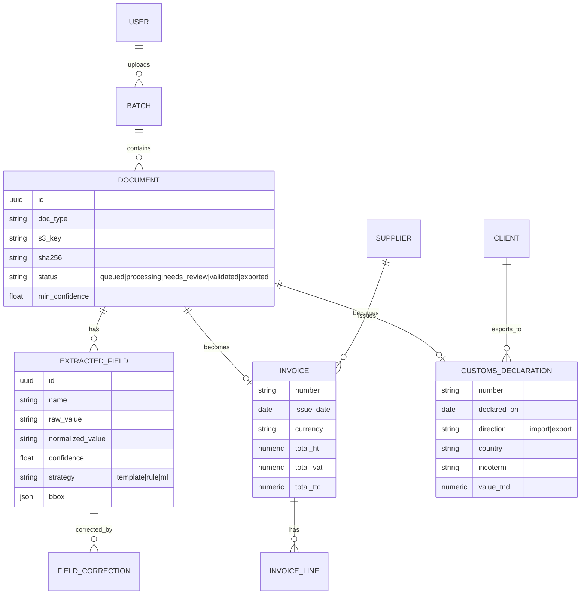
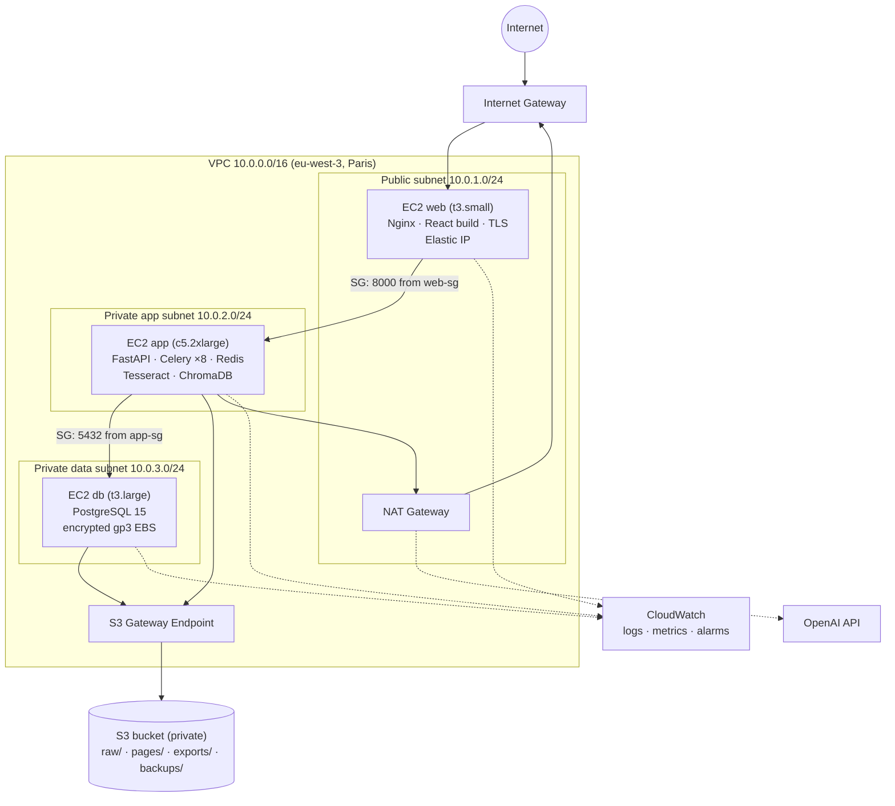

# 03 · Architecture & AWS Deployment

## 3-tier application design

| Tier | Component | Responsibilities |
|---|---|---|
| **Presentation** | React 18 + TypeScript, served by Nginx | Upload, batch tracking, review screen, Excel downloads, chatbot UI, admin (users, templates) |
| **Application** | FastAPI + Celery workers + Redis | REST API, auth (JWT + roles), OCR/extraction pipeline, Excel generation, RAG chatbot, ChromaDB |
| **Data** | PostgreSQL 15 | Users, batches, documents, extracted fields, corrections, business tables (invoices, declarations, suppliers, clients), audit log |
| *Object storage* | Amazon S3 | Raw PDFs, page images, generated Excel files, database backups |

### Data model (main tables)

### Main API endpoints

| Method | Endpoint | Purpose |
|---|---|---|
| `POST` | `/api/batches` | Create a batch (doc type, mode) and get pre-signed S3 upload URLs |
| `POST` | `/api/batches/{id}/start` | Start processing |
| `GET` | `/api/batches/{id}` | Progress, per-document status, flagged documents |
| `GET` | `/api/documents/{id}` | Extracted fields + bounding boxes + page image URLs |
| `PATCH` | `/api/documents/{id}/fields` | Human corrections / validation |
| `POST` | `/api/batches/{id}/export` | Generate or append the Excel workbook, and return a download URL |
| `POST` | `/api/chat` | Chatbot (Server-Sent Events streaming) |
| `GET` | `/api/health` | Health check for monitoring |

---

## AWS infrastructure

### Networking

- **One VPC, three subnet tiers.** Only the web server has a public IP. The app and database servers are in **private subnets** with no inbound access from the internet.
- **NAT Gateway** for outbound-only traffic from the app tier (OpenAI API, OS package updates).
- **S3 Gateway Endpoint:** S3 traffic stays on the AWS network (no NAT data charges, and the bucket policy only allows access through the endpoint).
- **Security groups chained by reference**, not by IP:

| Security group | Inbound | Source |
|---|---|---|
| `web-sg` | 443, 80 (→ redirect to 443) | `0.0.0.0/0` |
| `app-sg` | 8000 (FastAPI) | `web-sg` only |
| `db-sg` | 5432 (PostgreSQL) | `app-sg` only |

- **No SSH port open anywhere.** Admin access goes through **AWS Systems Manager Session Manager**, which is logged and needs no keys or bastion host.

### Compute (EC2)

| Instance | Type | Why |
|---|---|---|
| Web | `t3.small` | Static files + reverse proxy, low load |
| App | `c5.2xlarge` (8 vCPU, 16 GB) | OCR is CPU-bound; 8 vCPU = 8 parallel Celery workers |
| DB | `t3.large` (gp3 EBS 100 GB, encrypted) | Steady, moderate load |

Every server runs **Docker Compose** services under systemd, so they restart automatically after a reboot.

### Storage (S3)

- **Block Public Access** on, default **SSE-S3 encryption**, **versioning** enabled.
- Prefixes: `raw/` (uploaded PDFs), `pages/` (rendered page images for the review screen), `exports/` (Excel files), `backups/` (database dumps).
- **Lifecycle rules:** `pages/` deleted after 30 days (they can be regenerated). `raw/` moved to S3 Glacier Instant Retrieval after 180 days. `backups/` kept 35 days.
- Files reach users only through **pre-signed URLs** that expire after 15 minutes.

### IAM (least privilege)

- **EC2 instance roles**, so there are **no access keys on disk or in code**:
  - `app-role`: `s3:GetObject` / `s3:PutObject` on `raw/*`, `pages/*`, `exports/*` only, plus CloudWatch Logs write and SSM.
  - `db-role`: `s3:PutObject` on `backups/*` only, plus SSM and CloudWatch.
  - `web-role`: CloudWatch and SSM only.
- Human access: IAM users in groups (`admins`, `developers`) with **MFA enforced**. The root account is locked away with MFA and not used day to day.
- The bucket policy denies any request that doesn't use TLS (`aws:SecureTransport`) or doesn't come through the VPC endpoint (with an exception for the admin role).
- Secrets (DB password, OpenAI key, JWT secret) are in **SSM Parameter Store (SecureString)** and read by the app at startup.

### Operations

- **TLS** with Let's Encrypt (certbot auto-renew) on Nginx, HSTS enabled.
- **Backups:** nightly `pg_dump` → S3 (35-day retention) + daily **EBS snapshots** (Data Lifecycle Manager, 7 days). A restore was **tested monthly** on a throwaway instance.
- **Monitoring:** CloudWatch agent (CPU, memory, disk), container logs shipped to CloudWatch Logs, and alarms (CPU > 85% for 15 min, disk > 80%, health check failing) → SNS email to IT.
- **CI/CD:** GitHub Actions runs lint + tests → builds Docker images → pushes to Amazon ECR → deploys through **SSM Run Command** (`docker compose pull && docker compose up -d`). That way the private servers never need inbound access for deployments.
- **Cost:** about **$230 / month** for the whole environment (the NAT Gateway and the c5 instance being the largest items). That was well below the cost of the manual data-entry time it replaced.
